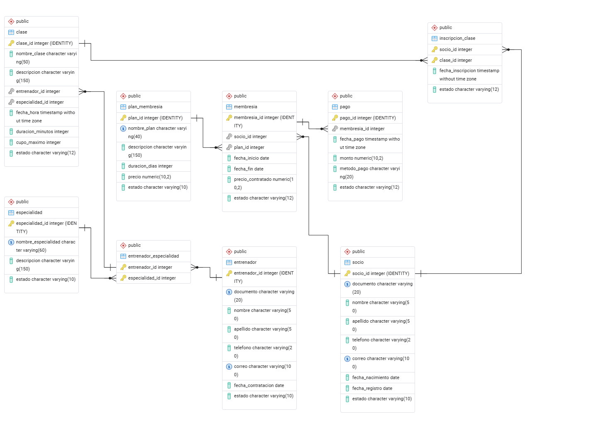

# Gimnasio Corlau — Sistema Integral de Gestión

Aplicación web desarrollada en **Python (Flask)** y **PostgreSQL** para la administración operativa de un gimnasio, implementando operaciones CRUD completas sobre un modelo relacional normalizado hasta la Tercera Forma Normal (3FN)


## Integrantes
* Laura Sofía Chaux Trujillo
* Miguel Ángel Cortés


## Descripción del proyecto

Gimnasio Corlau es una aplicación web diseñada para facilitar la administración de las operaciones de un gimnasio mediante una plataforma centralizada.

El sistema permite realizar operaciones CRUD (crear, consultar, actualizar y eliminar o desactivar registros) sobre los diferentes módulos, además de gestionar las relaciones entre las entidades y validar la información mediante restricciones en PostgreSQL.


## Tecnologías utilizadas

- *Python:* lenguaje de programación utilizado para la lógica del sistema.
- *Flask:* framework utilizado para desarrollar la aplicación web.
- *PostgreSQL:* sistema gestor de bases de datos.
- *Psycopg2:* conexión entre Python y PostgreSQL.
- *HTML5 y CSS3:* estructura y estilos de las páginas.
- *Bootstrap 5:* diseño adaptable e interfaz visual.
- *Jinja2:* generación dinámica de las plantillas HTML.
- *python-dotenv:* gestión de variables de entorno.


## Módulos del sistema

**Gimnasio Corlau** permite gestionar de manera centralizada:

1. *Socios:* registro, consulta, edición y desactivación de socios.
2. *Entrenadores:* administración de los entrenadores del gimnasio.
3. *Especialidades:* gestión de las disciplinas y áreas de entrenamiento.
4. *Entrenador - Especialidad:* asignación de especialidades a los entrenadores.
5. *Planes de membresía:* administración de planes, precios y duraciones.
6. *Membresías:* gestión de las membresías contratadas por los socios.
7. *Pagos:* registro y administración de los pagos de las membresías.
8. *Clases:* programación y administración de clases grupales.
9. *Inscripciones a clases:* registro y control de las inscripciones de los socios.

## Estructura del proyecto

text
Gimnasio_CorLau/
│
├── app.py
├── config.py
├── db.py
├── routes/
│   ├── __init__.py
│   ├── socios.py
│   ├── entrenadores.py
│   ├── especialidades.py
│   ├── planes_membresia.py
│   ├── entrenadores_especialidades.py
│   ├── membresias.py
│   ├── pagos.py
│   ├── clases.py
│   └── inscripciones_clase.py
│
├── templates/
├── static/
├── database/
├── docs/
├── tests/
│
├── requirements.txt
├── .env.example
├── .gitignore
└── README.md


## Modelo Entidad-Relación (MER)
La base de datos está diseñada cumpliendo **1FN, 2FN y 3FN**, garantizando integridad referencial mediante llaves primarias (`PK`) y llaves foráneas (`FK`):




## Instalación y Ejecución Local

### 1. Clonar el repositorio
```bash
git clone [https://github.com/tu-usuario/Proyectofinal_Programaci-nWeb.git](https://github.com/tu-usuario/Proyectofinal_Programaci-nWeb.git)
cd Proyectofinal_Programaci-nWeb
